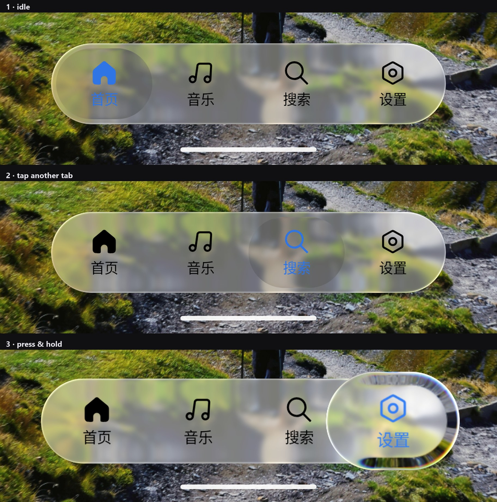

# Liquid Glass Navigation Bar

iOS 26 风格「液态玻璃」底部导航栏 · Jetpack Compose

可拖动的指示器、按下时的透镜折射与色散、跟随设备重力的镜面高光。



---

## ⚠️ 来源与致谢

这个组件的**源码和灵感都是复刻**自下面两个项目，不是原创设计：

| 项目 | 说明 |
| --- | --- |
| [**compose-miuix-ui/miuix**](https://github.com/compose-miuix-ui/miuix) | **源码来源。** `liquid/` 下的 7 个实现文件直接改编自 miuix 的 blur / backdrop 模块与 Apple 风格 tabs。整条渲染管线——backdrop 图层捕获、AGSL 圆角矩形折射着色器、镜面高光（`BloomStroke`）、阻尼拖拽状态机——都来自这里 |
| [**Kyant0/AndroidLiquidGlass**](https://github.com/Kyant0/AndroidLiquidGlass) | **灵感来源。** 液态玻璃视觉效果的原型，miuix 的实现本身也跟随它 |

两者均为 **Apache-2.0**。所有改编文件保留原始版权头，完整归属声明见 [NOTICE](NOTICE)。

如果你要基于这套效果做产品，建议直接依赖 miuix 官方组件，而不是这个仓库。

---

## Demo

直接安装：[`demo/liquid-glass-demo.apk`](demo/liquid-glass-demo.apk)（R8 压缩后约 6.5 MB，debug 密钥签名，可直接侧载）

```bash
adb install -r demo/liquid-glass-demo.apk
```

素材来自 [Pexels](https://www.pexels.com/) 的免费图库照片，仅用于展示玻璃采样效果。

---

## 用起来

### 1. 依赖

把 `:liquid` 模块拷进你的工程，或者发布到本地 Maven 后引用：

```kotlin
implementation(project(":liquid"))
```

库的公开 API 只用到 `androidx.compose.ui` 和 miuix 的 `LayerBackdrop`，Compose / miuix 的版本由 `api` 传递，调用方不需要再对齐版本。

### 2. 最小用法

```kotlin
LiquidGlassScaffold(
    bottomBar = {
        LiquidGlassNavigationBar(
            tabs = listOf(
                LiquidTab("首页", MiuixIcons.Home),
                LiquidTab("音乐", MiuixIcons.Music),
                LiquidTab("搜索", MiuixIcons.Search),
                LiquidTab("设置", MiuixIcons.Settings),
            ),
            selectedIndex = selected,
            onTabClick = { selected = it },
        )
    },
) {
    Image(bitmap = background, contentDescription = null, contentScale = ContentScale.Crop)
}
```

`LiquidGlassScaffold` 会把 `content` 录进一个 backdrop 图层供底栏采样——这是玻璃效果的前提，所以底栏必须放在 `bottomBar` 而不是 `content` 里面。

### 3. API

| 名称 | 说明 |
| --- | --- |
| `LiquidTab(label, icon)` | 一个导航项。不依赖 miuix 的 `NavigationItem`，调用方只需要 Compose |
| `LiquidGlassScaffold(scrimColor, bottomBar, content)` | 建立 backdrop，录制 `content`，把底栏固定在底部 |
| `LiquidGlassNavigationBar(tabs, selectedIndex, onTabClick, backdrop)` | 底栏本体。`backdrop` 默认取 `LocalLiquidGlassBackdrop`，也可显式传入以采样别的图层 |
| `LocalLiquidGlassBackdrop` | 当前 backdrop。手写布局时可直接读取 |

`:liquid` 里的 7 个实现文件全部是 `internal`，公开面只有 `LiquidGlass.kt` 一个文件。

---

## 效果是怎么来的

- **容器层**：`blur(4dp)` + `vibrancy()`（`saturation = 1.5`）+ 24dp 的边缘折射透镜，再刷一层 40% 的色彩底
- **指示器层**：采样「页面背景 + 已渲染的玻璃层」的组合 backdrop，再叠加一次折射、`chromaticAberration = 0.5` 的色散、以及按下时才出现的内阴影
- **高光**：`rememberDeviceTilt()` 读加速度计得到屏幕平面内的重力方向，量化到 3° 后旋转主光源，所以倾斜手机会看到反光在动
- **降级链**：无 `RuntimeShader`（Android 13 以下）→ 纯色胶囊；`backdrop == null` → 不做玻璃采样

一处实现注记：按下时那层 6% 白色叠加原本用 `spring(0.5f, 300f)`，阻尼比 0.5 是欠阻尼，松手动画会冲过 0 变负，配合绘制处的 `progress > 0f` 早退会让整条底栏的亮度先跌破静止值再弹回，看起来是边缘「跳一下」。这里改成了临界阻尼并把叠加裁剪到胶囊轮廓内。

---

## 模块结构

```
:liquid    液态玻璃底栏库（7 个实现文件 + 1 个公开 API 文件）
:app       演示 App：一张全屏照片 + 底栏
```

## 构建

```bash
./gradlew :app:assembleRelease    # demo APK
./gradlew :liquid:assembleRelease # 库 AAR
```

| 项 | 版本 |
| --- | --- |
| JDK | 17 |
| Gradle | 9.7.1 |
| AGP | 9.4.1（内置 Kotlin 支持，无需 `kotlin-android` 插件） |
| Kotlin / Compose 插件 | 2.4.21 |
| Compose BOM | 2026.09.00 |
| miuix | 0.9.4-rc01 |
| compileSdk / minSdk | 37 / 33 |

> Compose 1.12 及 miuix 0.9.4 要求 `compileSdk >= 37`，SDK 里对应的包名是 `platforms/android-37.0`。

## License

[Apache License 2.0](LICENSE)
